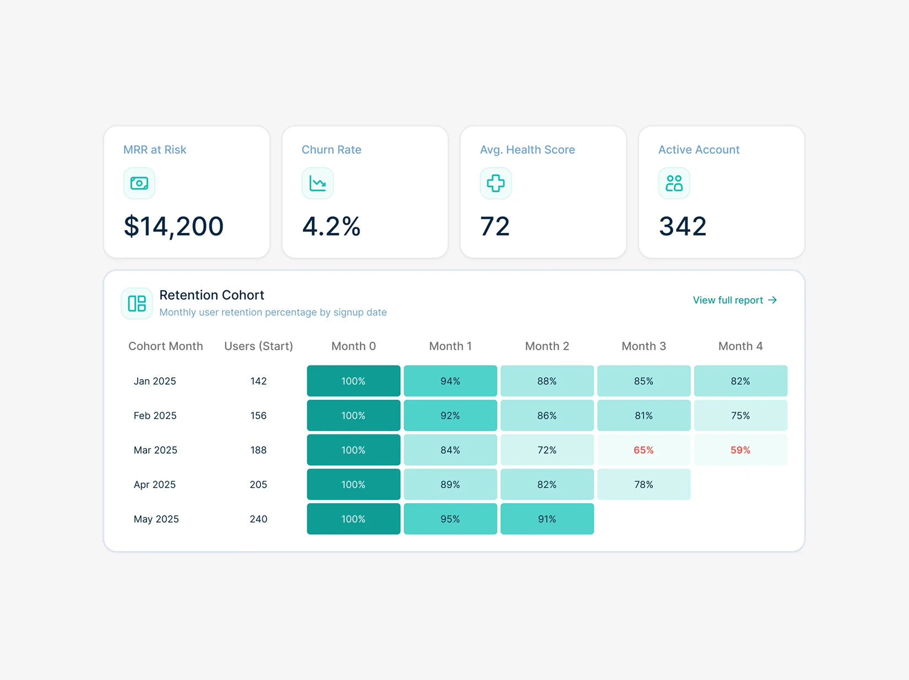
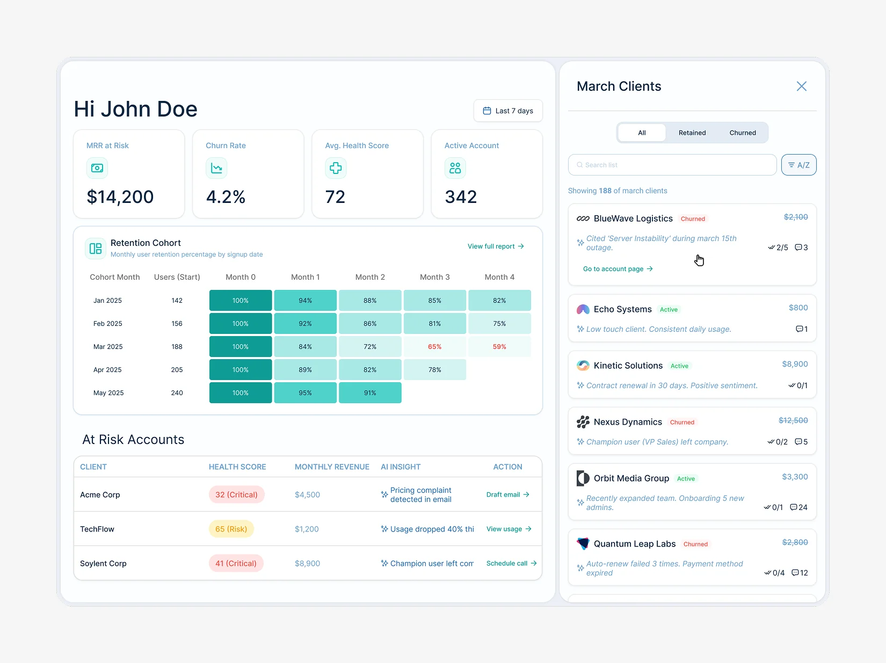

## Overview

**Good data should make the next step clearer.** This sample case study uses Retain AI, a retention dashboard concept, to show how a project explanation can connect the problem, design decisions, and final experience.

Introduce your project here: what it is, who it serves, and why the work mattered. Keep this opening short enough for someone to understand the project before scrolling further.

### My contribution

Explain the part you owned, the people you worked with, and where your responsibility started and ended. Separate your decisions from the team's work.

## The problem

Describe the situation before the project. What were people trying to accomplish, what got in their way, and why was solving it worthwhile?

For this example, the central design question is:

> How might we help a customer success team see which accounts need attention and decide what to do next?

Replace this question with the problem you actually worked on. Add the evidence that informed it: an observation, a support theme, or a research finding.

### What success would look like

- **For the user:** Describe the task or decision that should become easier.
- **For the business:** Explain the outcome this work should support.
- **Within the constraints:** Note the limits on time, scope, technology, or available data.

## The process

Tell the story through decisions. Show what you learned, what changed, and why you chose one direction over another.

### 01 — Understand the context

Describe the research or discovery you actually did. Who did you learn from, which questions did you explore, and what did the evidence reveal?

### 02 — Explore the options

Show an early direction and explain its trade-offs. A sketch, flow, or comparison can make your reasoning easier to follow than a list of activities.

### 03 — Refine the direction

Explain how feedback shaped the design. Include a specific before-and-after decision and the reason for it.

## The solution

Use the final screens to explain how the experience addresses the original problem. Give each image a purpose and describe the decision it illustrates.

### Start with the signals that matter

The example dashboard puts summary metrics, retention cohorts, and at-risk accounts in one view. In your own project, explain how the information hierarchy helps someone complete their task.

<figure>
  
  <figcaption>Example supporting visual. Replace this caption with the design decision the screen demonstrates. Select the image to view it at full size.</figcaption>
</figure>

### Connect information to the next step

Show how the experience moves from understanding a situation to taking action. Explain the details that make this transition clear, including the alternatives you considered.

<figure>
  
  <figcaption>Example supporting visual. Use this space to explain an interaction, a refinement, or a key detail.</figcaption>
</figure>

## Outcomes

Close the loop on your original definition of success. Report only results you can support, and distinguish a shipped result from a prototype observation.

- **What changed:** Describe a verified improvement or the final deliverable.
- **How you know:** Include the measurement, feedback, or evidence behind it.
- **What remains:** Be clear about what has not been tested or measured yet.

For a concept project, describe what the exploration demonstrated and what you would validate next instead of adding hypothetical business metrics.

## Learnings

Share one or two specific lessons from the work. What surprised you? Which assumption changed? What would you do differently with another iteration?

End with the next question you would explore. This is a place to show your judgment as a designer, alongside the final screens.
